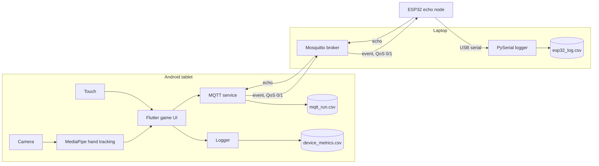

# AetherGrid ( Code is currently under maintenance, fixing minor bugs) 

A pilot study measuring the system and user cost of vision-based gesture input versus touch on an edge-hosted tablet application.

AetherGrid is a Flutter math game ("Aether Grid") that can be played with touch or with mid-air hand gestures tracked on-device by MediaPipe. A local MQTT broker and an ESP32 echo node let us separate the cost of the vision pipeline from the cost of the network, and a set of logging and analysis scripts turns each run into comparable data.

> **Status:** pilot study in progress. The system, logging pipeline, and study protocol are built. Results will be added once data collection and analysis are complete.

## Research questions

**Main question:** How does a vision-based spatial gesture interface compare with physical touch in end-to-end latency, selection accuracy, and perceived usability in an edge-hosted math-learning application, and how much of the cost comes from the vision pipeline rather than the network?

- **RQ1:** What is the impact of continuous on-device hand tracking (MediaPipe) on the tablet's frame rate and frame times, and do MQTT QoS 0 and QoS 1 differ in round-trip time and message loss on a dedicated local network?
- **RQ2:** How do gesture and touch input compare in end-to-end latency (video-measured on a subset of trials), in-app latency, selection time, selection accuracy, and observer-labeled false positives and negatives in the same target-selection task?
- **RQ3:** How do users rate gesture and touch in usability, workload, and arm fatigue, and which do they prefer?

## System architecture



| Tier | Role |
|---|---|
| **1. Flutter client (tablet)** | Game UI, MediaPipe hand tracking, per-trial and frame logging, MQTT publishing, and RTT measurement |
| **2. Mosquitto (laptop)** | Local MQTT broker on a dedicated 2.4 GHz network, tested at QoS 0 and QoS 1 |
| **3. ESP32** | Hardware echo node: returns each event immediately, so network delay and microcontroller delay can be measured separately |
| **4. Python (laptop)** | USB-serial capture of ESP32 telemetry, plus data cleaning and statistics |

In benchmark runs the ESP32 is a pure echo node. Its LEDs, buzzer, and button are for the demo only.

## Tech stack

| Area | Tools |
|---|---|
| App | Flutter, Dart, Google MediaPipe (hand tracking), Dart MQTT client |
| Broker | Eclipse Mosquitto |
| Firmware | C++ / Arduino core, ArduinoMqttClient, ArduinoJson, `esp_timer` microsecond timestamps |
| Telemetry and analysis | Python 3, PySerial, Pandas, SciPy, Matplotlib |
| Measurement | 120 fps phone camera for end-to-end latency, SUS, NASA-TLX, Borg CR10 |

Test hardware: Xiaomi Pad 6 (tablet, display up to 144 Hz), ESP32 dev board, laptop running Mosquitto, Realme Narzo 50 5G (120 fps video).

## Repository structure

Adjust to match your repo.

```
.
├── app/                    # Flutter app (Aether Grid game, logging, MQTT service)
├── firmware/
│   ├── esp32_aethergrid.ino
│   └── secrets.example.h   # copy to secrets.h (git-ignored)
├── tools/
│   ├── esp32_logger.py     # PySerial capture -> esp32_log CSV
│   └── analyze_infra.py    # join logs, summarize RTT, frames, stats
├── docs/                   # slides, diagrams, protocol notes
├── data/                   # local only, git-ignored (see "Data and privacy")
└── README.md
```

## Getting started

### Prerequisites

- Flutter SDK and an Android tablet with a front camera
- Mosquitto on the laptop
- Arduino IDE (or PlatformIO) with the ESP32 board package, plus the `ArduinoMqttClient` and `ArduinoJson` libraries
- Python 3.10+ with `pyserial`, `pandas`, `numpy`, `scipy`, `matplotlib`

### 1. Start the broker

Mosquitto 2.x only accepts local connections by default. For an isolated test network, a minimal `mosquitto.conf`:

```
listener 1883
allow_anonymous true
```

Run it with `mosquitto -c mosquitto.conf -v`. Do not use `allow_anonymous true` on a network you do not control.

### 2. Flash the ESP32

1. Copy `firmware/secrets.example.h` to `firmware/secrets.h` and fill in your Wi-Fi name and password. Never commit `secrets.h`.
2. Set the broker IP in `esp32_aethergrid.ino`.
3. Keep `BENCHMARK_MODE = true` for measurement runs. Set it to `false` for the demo.
4. Flash the board and open the serial monitor at 921600 baud.

Commands are sent to the topic `smg/esp32/cmd`:

| Command | Effect |
|---|---|
| `run:<label>` | Sets the run label and resets counters |
| `qos0` / `qos1` | Sets the QoS of the echo |
| `reset` | Resets counters |

### 3. Run the tablet app

```bash
cd app
flutter pub get
flutter run --release
```

Set the broker address in the app's config. Use `--release` for measurements, because debug builds distort frame timings.

### 4. Capture ESP32 telemetry

```bash
cd tools
# edit PORT and the output directory at the top of the script
python esp32_logger.py
```

This writes a raw log, a parsed `esp32_log_*.csv`, and a `esp32_sys_*.csv` of events such as run labels and resets.

### 5. Analyze

```bash
python tools/analyze_infra.py \
  --mqtt mqtt_run.csv \
  --esp esp32_log_*.csv \
  --device device_metrics.csv \
  --out results
```

This joins the tablet and ESP32 logs on `run_label` + `seq` and reports RTT (median, p95, p99), loss, ESP32 processing time, frame statistics, and, if participant and mode columns exist, a paired Wilcoxon test on per-participant medians.

## Data files

| File | Written by | Contents |
|---|---|---|
| `device_metrics.csv` | Flutter app | Frame, build, and raster times, MediaPipe inference time, in-app input latency, per-trial prompt, target, selection, outcome, and selection time |
| `mqtt_run.csv` | Flutter app | Per-event RTT, matched by `seq`, with QoS and run label |
| `esp32_log.csv` | `esp32_logger.py` | ESP32 processing time, inter-arrival time, lost, duplicate, and out-of-order counters, queue drops, RSSI |
| `latency_video.csv` | Manual | Frame-counted end-to-end latency from 120 fps video |
| `surveys.csv` | Manual | SUS, NASA-TLX, Borg CR10, preference |
| `observer_labels.csv` | Manual | Observer-labeled false negatives and false positives per trial |

Join key for per-trial data: `participant_id` + `mode` + `trial_id`.

## Study protocol

1. **Infrastructure benchmark (no participants):** QoS 0 vs QoS 1, 500 timestamped events per run, 3 runs each, on a dedicated 2.4 GHz network.
2. **Within-subjects pilot:** 6 adult volunteers, touch vs gesture, order counterbalanced. 20-30 trials per condition after a practice block. Fixed level and matched problem sets, with hints disabled during trials.
3. **Surveys:** SUS, NASA-TLX, and Borg CR10 after each condition, plus a preference question and short open-ended questions.

End-to-end latency is measured on a random subset of trials (5 per mode per participant) by frame-counting 120 fps video of the hand and the screen.

## Measurement notes and limitations

- **In-app latency is not end-to-end latency.** Touch is measured from pointer-up to the next Flutter frame, and gesture from camera capture to the cursor update. The two start points differ, so cross-mode latency comes from the video measurement.
- **Video resolution:** at 120 fps one frame is about 8.3 ms, so frame-counted latency is accurate to about one frame, plus display refresh granularity.
- **Clocks are not synchronized** between the tablet and the ESP32. Only durations are compared across devices.
- **Frame budget:** dropped frames are counted against the display frame budget (6.9 ms at 144 Hz), to be verified against the actual refresh rate.
- **Pilot size:** n = 6 supports descriptive findings, not strong generalizations. Participants are adults, so results may not carry over to children.
- **False positives and negatives** need an observer, because the app cannot infer intent.

## Data and privacy

Raw participant data, survey responses, and video recordings are not included in this repository. Store them locally under participant IDs, never names, and keep them out of version control (see `.gitignore`).

Suggested `.gitignore` entries:

```
firmware/secrets.h
data/
*.mp4
*.mov
```

## Contributors

- **Theresia Mulyadi:** gesture input and MediaPipe integration, MQTT and ESP32 pipeline, logging, study design, and analysis
- **Irma:** hint feature (disabled during trials), board base template, level progression, Dijkstra's shortest-path algorithm

## References

- Fallah, S., & MacKenzie, I. S. (2024). Comparing Fun and Performance: A User Study on Children's Gaming Experiences with Mid-Air Hand Gestures. *Proceedings of BCS HCI 2024.* DOI: 10.14236/ewic/BCSHCI2024.12
- Hincapié-Ramos, J. D., Guo, X., Moghadasian, P., & Irani, P. (2014). Consumed Endurance: A Metric to Quantify Arm Fatigue of Mid-Air Interactions. *CHI '14.*
- Zaina, L., Castro, E., Martinelli, S., & Sakata, T. (2019). Educational games and the new forms of interactions: Exploring the use of hand gestures in a computational thinking game. *Smart Learning Environments, 6.*
- Zhang, F., et al. (2020). MediaPipe Hands: On-device Real-time Hand Tracking. *CVPR Workshop on Computer Vision for AR/VR.* arXiv:2006.10214
- Borsatti, D., Cerroni, W., Tonini, F., & Raffaelli, C. (2020). From IoT to Cloud: Applications and Performance of the MQTT Protocol. *ICTON 2020.* DOI: 10.1109/ICTON51198.2020.9203167

## License

[Choose a license, for example MIT, and add a `LICENSE` file.]
